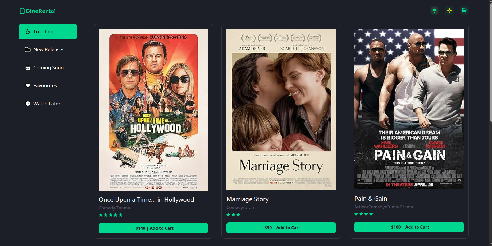
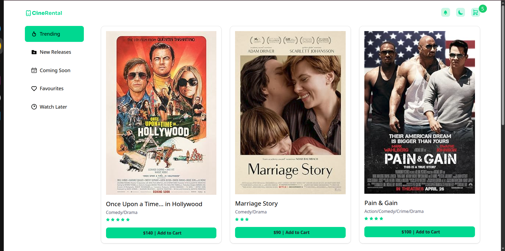
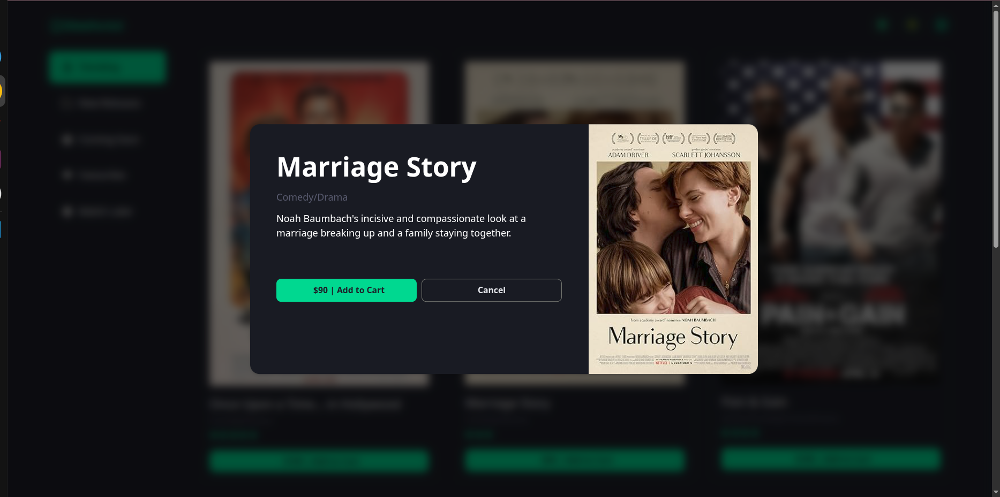
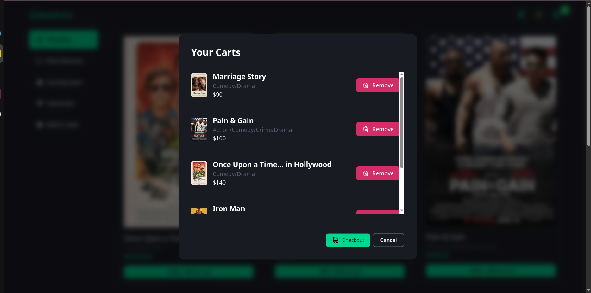
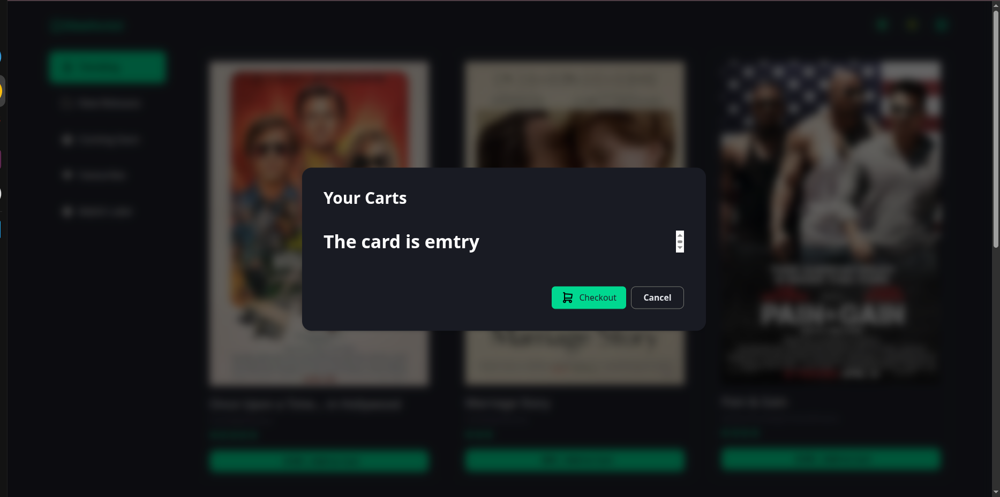
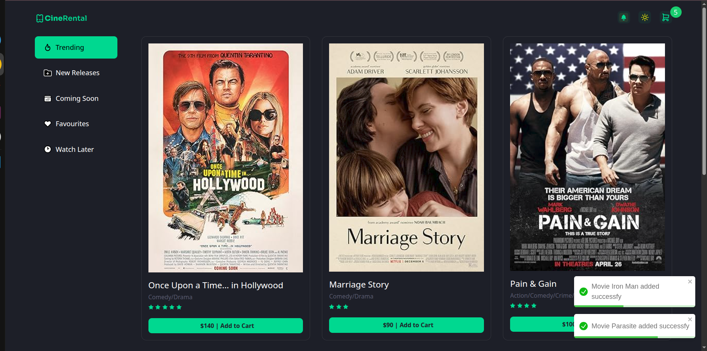
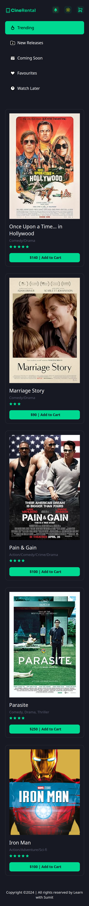
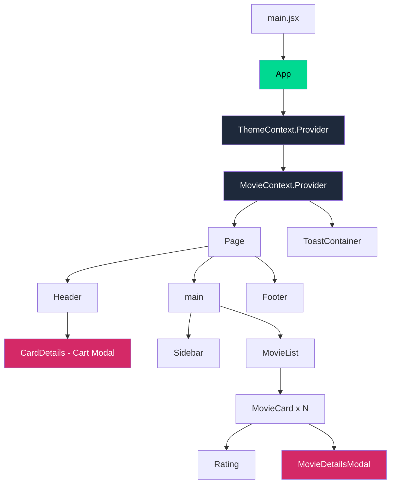
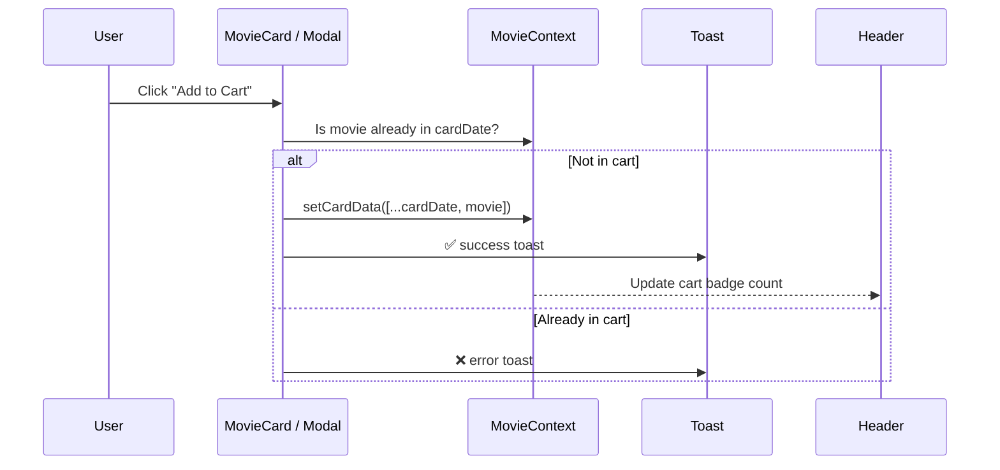

<div align="center">

# 🎬 Cinema — Movie Cart App

A modern, responsive movie browsing & cart experience built with **React**, **Tailwind CSS v4** and the **Context API**.


</div>

---

## 📑 Table of Contents

- [✨ Features](#-features)
- [📸 Screenshots](#-screenshots)
- [🛠 Tech Stack](#-tech-stack)
- [🏗 Project Architecture](#-project-architecture)
- [🧩 Component Tree](#-component-tree)
- [🔄 State & Data Flow](#-state--data-flow)
- [🚀 Getting Started](#-getting-started)
- [🗺 Roadmap](#-roadmap)
- [🙌 Acknowledgements](#-acknowledgements)

---

## ✨ Features

| Feature                    | Description                                                                     |
| -------------------------- | ------------------------------------------------------------------------------- |
| 🎞 **Movie Grid**          | Responsive grid (1 → 2 → 3 columns) showing cover, title, genre, rating & price |
| 🔍 **Movie Details Modal** | Click any card to see the full description in a beautiful modal                 |
| 🛒 **Add to Cart**         | Add movies from the card or the modal — duplicates are prevented                |
| 🗑 **Cart Management**     | View all cart items in a modal and remove any of them                           |
| 🔢 **Live Cart Badge**     | Header cart icon shows the number of items in real time                         |
| 🌗 **Dark / Light Mode**   | One-click theme toggle (dark by default)                                        |
| 🔔 **Toast Notifications** | Success / error feedback via `react-toastify`                                   |
| ⭐ **Star Rating**         | Reusable `Rating` component renders stars from a numeric value                  |
| 📱 **Fully Responsive**    | Works smoothly on mobile, tablet and desktop                                    |

---

## 📸 Screenshots

> 💡 Put your screenshots inside `src/assets/Sreecshot/` using the file names below.

### 🏠 Home Page

|                     Dark Mode                     |                     Light Mode                      |
| :-----------------------------------------------: | :-------------------------------------------------: |
|  |  |

### 🎥 Movie Details Modal

<p align="center">
  
</p>

### 🛒 Cart Modal

|                    With Items                    |                     Empty Cart                      |
| :----------------------------------------------: | :-------------------------------------------------: |
|  |  |

### 🔔 Toast Notifications

<p align="center">
  
</p>

### 📱 Mobile View

<p align="center">
  
</p>

---

## 🛠 Tech Stack

- **[React](https://react.dev/)** — UI library (Hooks: `useState`, `useContext`)
- **[Vite](https://vitejs.dev/)** — Lightning-fast dev server & bundler
- **[Tailwind CSS v4](https://tailwindcss.com/)** — Utility-first styling with custom theme tokens
- **[React Toastify](https://fkhadra.github.io/react-toastify/)** — Toast notifications
- **Context API** — Global state for the cart and theme

---

## 🏗 Project Architecture

```text
📦 cinema-app
├── 📂 public
├── 📂 src
│   ├── 📂 assets
│   │   ├── 📂 icons                # moon, sun, checkout, sidebar icons...
│   │   ├── 📂 movie-covers         # movie poster images
│   │   ├── home-dark.png           # README screenshots
│   │   ├── home-light.png
│   │   ├── movie-details.png
│   │   ├── cart.png
│   │   ├── cart-empty.png
│   │   ├── toast.png
│   │   ├── mobile.png
│   │   ├── logo.svg
│   │   ├── ring.svg
│   │   ├── shopping-cart.svg
│   │   ├── star.svg
│   │   └── delete.svg
│   │
│   ├── 📂 cinema                   # 🎬 Movie-related feature components
│   │   ├── MovieList.jsx           # Renders the grid of movies
│   │   ├── MovieCard.jsx           # Single movie card + add-to-cart logic
│   │   ├── MovieDetailsModal.jsx   # Movie details popup
│   │   ├── CardDetails.jsx         # Cart popup (list / remove items)
│   │   └── Rating.jsx              # Star rating display
│   │
│   ├── 📂 context
│   │   └── index.js                # MovieContext & ThemeContext
│   │
│   ├── 📂 data
│   │   └── movies.js               # Static movie data + getAllMovies()
│   │
│   ├── 📂 utils
│   │   └── cinema-utility.js       # getImgUrl() helper
│   │
│   ├── App.jsx                     # Providers (Theme + Movie) + ToastContainer
│   ├── Page.jsx                    # Page layout & dark-mode wrapper
│   ├── Header.jsx                  # Logo, theme toggle, cart button
│   ├── Sidebar.jsx                 # Navigation links
│   ├── Footer.jsx                  # Copyright footer
│   ├── index.css                   # Tailwind import + theme config
│   └── main.jsx                    # App entry point
│
├── index.html
├── package.json
└── vite.config.js
```

---

## 🧩 Component Tree

```text
main.jsx
└── <App />                                  ← state: cardDate, darkMode
    ├── <ThemeContext.Provider>
    │   └── <MovieContext.Provider>
    │       ├── <Page />                     ← applies "dark" class
    │       │   ├── <Header />
    │       │   │   └── <CardDetails />      ← cart modal (conditional)
    │       │   ├── <main>
    │       │   │   ├── <Sidebar />
    │       │   │   └── <MovieList />
    │       │   │       └── <MovieCard />  × N
    │       │   │           ├── <Rating />
    │       │   │           └── <MovieDetailsModal />   ← (conditional)
    │       │   └── <Footer />
    │       └── <ToastContainer />
```

### Visual Diagram



---

## 🔄 State & Data Flow

### Global State (Context API)

| Context        | Value                       | Defined In | Used By                              |
| -------------- | --------------------------- | ---------- | ------------------------------------ |
| `ThemeContext` | `{ darkMode, setDarkMode }` | `App.jsx`  | `Page`, `Header`                     |
| `MovieContext` | `{ cardDate, setCardData }` | `App.jsx`  | `Header`, `MovieCard`, `CardDetails` |

### Add-to-Cart Flow



---

## 🚀 Getting Started

### Prerequisites

- **Node.js** `v18+`
- **npm** or **yarn**

### Installation

```bash
# 1. Clone the repository
git clone https://github.com/mdnasimhosen22/CineRental

# 2. Go to the project folder
cd CineRental

# 3. Install dependencies
npm install

# 4. Start the dev server
npm run dev
```

Open **http://localhost:5173** in your browser 🎉

### Available Scripts

| Command           | Description                  |
| ----------------- | ---------------------------- |
| `npm run dev`     | Start development server     |
| `npm run build`   | Create a production build    |
| `npm run preview` | Preview the production build |
| `npm run lint`    | Run ESLint                   |

---

## 🎨 Theme Customization

Custom colors are defined in `src/index.css` using Tailwind v4's `@theme`:

```css
@theme {
  --color-primary: #00d991;
  --color-dark-bg: #171923;
}
```

Dark mode is class-based via a custom variant:

```css
@custom-variant dark (&:where(.dark, .dark *));
```

---

## 🗺 Roadmap

- [ ] Fetch movies from a real API (TMDB / custom backend)
- [ ] Persist cart in `localStorage`
- [ ] Persist theme preference
- [ ] Search, filter & sort movies
- [ ] Quantity controls + total price in the cart
- [ ] Functional sidebar categories (Trending, New Releases...)
- [ ] Checkout flow
- [ ] Unit tests with Vitest + React Testing Library

---

## 🤝 Contributing

Contributions, issues and feature requests are welcome!

1. Fork the project
2. Create your branch: `git checkout -b feature/amazing-feature`
3. Commit your changes: `git commit -m "Add amazing feature"`
4. Push to the branch: `git push origin feature/amazing-feature`
5. Open a Pull Request

---

## 🙌 Acknowledgements

- UI design & course inspiration: **Learn with Sumit**
- Icons & movie posters belong to their respective owners

---

<div align="center">

Made with ❤️ and ☕ using React

⭐ If you like this project, give it a star!

</div>
